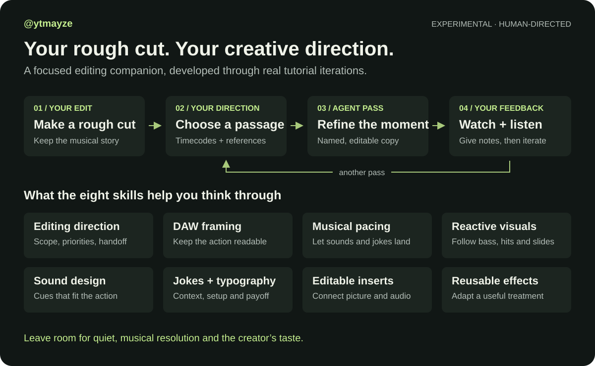
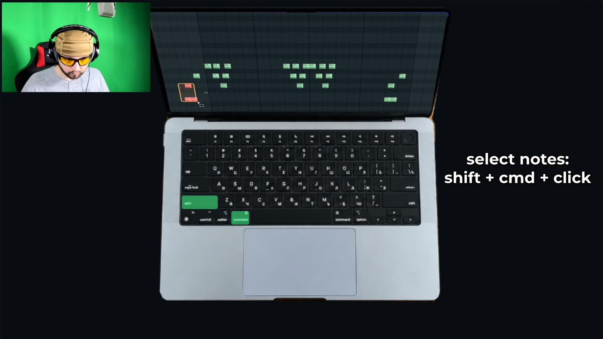
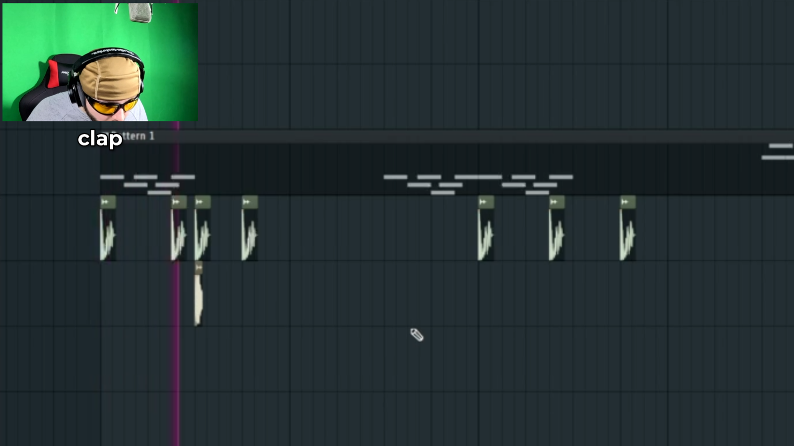

# ytmayze video editing

A developing set of eight agent skills for fast-paced engaging music-production tutorials: focused FL screen framing, musical pacing, reactive effects, action-matched sound, contextual humor, and editable inserts.

[human written: start]

These skills were built from two real edits, **making slop** (https://youtu.be/S_UFBbEQlFs) and **Cranky Glo** (https://youtu.be/c5-xFglvO5I). In both cases, A human made the rough cut first, then directed many rounds of agent-assisted refinement. The workflow starts with your rough cut and develops through your direction and feedback. Its best to first nail cuts/pacing then move to positioning, framing, crops, then animation (zooms, movement, etc). Next vfx, sfx, and memes as finishing touches. You can let your agent decide everything on its own but youll likely burn through usage with nothing to show for other than broken dreams (even a tiny bit of direction goes a long way). Raw-footage cutting and complete tutorials from one prompt remain untested. The agent needs your taste and feedback.

[human written: end]



## Install

```sh
npx skills add mmm-mmm-mmm-m/ytmayze-video-editing
```

Choose all eight skills in the installer. To ask your agent to install them:

> Install all eight skills from https://github.com/mmm-mmm-mmm-m/ytmayze-video-editing. Inspect them first, preserve any existing same-named skills, and tell me where they were installed. Do not edit any media yet.

In Codex, invoke the main skill with `$ytmayze-video-editing`. In Claude Code, use `/ytmayze-video-editing`.

[human written: start]

## A practical workflow

Make a rough cut first, then give your agent the editable project and its media. Start with one short passage. Name the exact in and out timecodes, what you want to improve, and what must stay the same. Attach any style references, drawings, images, audio, or memes. Explain exactly what is happening, give it context (in the clip before xyz was happening, its important because xyz, in this clip xyz, it feels slow, preserve the music but it needs something on screen to bring energy while the musical phrase is landing). If something is missing, tell the agent whether it may source material and feed it your taste throughout (i like...). Review the passage, give concrete feedback, and iterate.

[human written: end]

For example:

> Use `$ytmayze-video-editing` on my rough-cut project. Work only from **01:12 to 01:28**. Make the piano-roll notes easier to follow while keeping the complete note-entry gesture, original cut points, beat playback, and webcam position unchanged. Use the attached framing sketch as a reference. Make a named editable copy, show me this passage for review, and tell me what you actually inspected. Do not source outside media.

See [Usage](docs/USAGE.md) for a fuller prompt and workflow. The agent needs access to your editor, project, and media to make changes; without that access it can still review provided materials or suggest an edit plan. HyperFrames is optional and requires a separate installation.

## The skills

| Skill | Focus |
| --- | --- |
| `ytmayze-video-editing` | Broad review and edit planning; routes work to focused guidance |
| `ytmayze-frame-daw` | DAW crops, mouse and playhead tracking, webcam placement, vertical framing |
| `ytmayze-pace-music` | Musical breathing room, note-building continuity, comedy holds and reveals |
| `ytmayze-reactive-vfx` | Pumps, bass motion, slides, glow and distortion tied to sound or action |
| `ytmayze-design-sound` | Action-matched foley, transitions, dialogue and SFX balance |
| `ytmayze-engagement` | Contextual memes, captions, lyric typography and CTA cards |
| `ytmayze-hyperframes-inserts` | Editable HyperFrames inserts with source-audio timing |
| `ytmayze-effect-presets` | Reusable editable effects, layouts and composites |

Sound, framing, pacing and entertainment layers are areas this workflow explores. Results depend on the footage, tools, direction and review; no outcome is guaranteed.

## Examples

The images below are **source-style examples** from **making slop** (https://youtu.be/S_UFBbEQlFs), one of the edits that informed the skills. They are not demonstrations that this public release independently produced those edits.





No raw project media or templates are bundled. See [Contributing](CONTRIBUTING.md) and the [release protocol](docs/RELEASE-PROTOCOL.md).

## License

License decision pending; see [License options](docs/LICENSE-OPTIONS.md).

Made by [@ytmayze](https://www.youtube.com/@ytmayze) · from [rooot.online](https://rooot.online)
